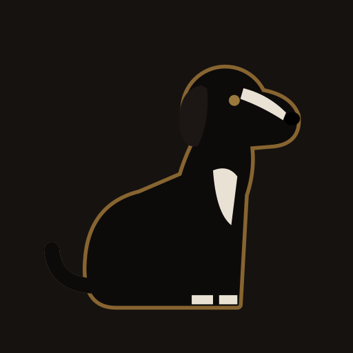

<p align="center">
  <a href="https://keepitterron.github.io/black-dog-lane/"></a>
</p>

<h1 align="center">Black Dog Lane</h1>

<p align="center"><strong><a href="https://keepitterron.github.io/black-dog-lane/">Play it: keepitterron.github.io/black-dog-lane</a></strong></p>

A small, creepy point-and-click puzzle game in the spirit of Rusty Lake, made for a parent and a nine-year-old to play together on one phone. Each level is three chapters of rooms, clues and things that move when you look away. Levels are pure data: a local generator turns a one-line theme into a validated level, so the people who play it see it for the first time when they open it.

## Playing

Open the link on a phone and add it to the home screen (Share → Add to Home Screen on iOS, Install app on Android). It works offline once installed and keeps a save per level.

Tap things to look closer, swipe or use the arrows to turn, tap an item to select it and then tap where to use it. Stuck? Ask for a hint: each one gets a little more direct.

## Developing

Node 24, npm. Vite + React + TypeScript, Valibot for the level schema, Vitest, Oxlint. Art is parametric SVG and sound is synthesized with Web Audio, so there are no image or audio files.

```bash
npm install
npm run dev          # dev server
npm run lint         # Oxlint with type checking (the only type check)
npm test             # Vitest, including validating every level
npm run build        # production build, then `npm run preview`
npm run fixtures     # rebuild test levels from scripts/levels/*.ts
npm run validate -- [--fixture] <file…>   # spoiler-free level report
```

Pushing to `main` deploys to GitHub Pages.

**Spoilers:** real levels live encoded in `levels/play/` and are played blind. Don't open them, and don't put their content in commits, PRs or logs. Work against the fixtures in `levels/test/` instead.

More detail: [CLAUDE.md](CLAUDE.md) for the working rules, [docs/handoff.md](docs/handoff.md) for the full spec and milestones.
